<p align="center">
  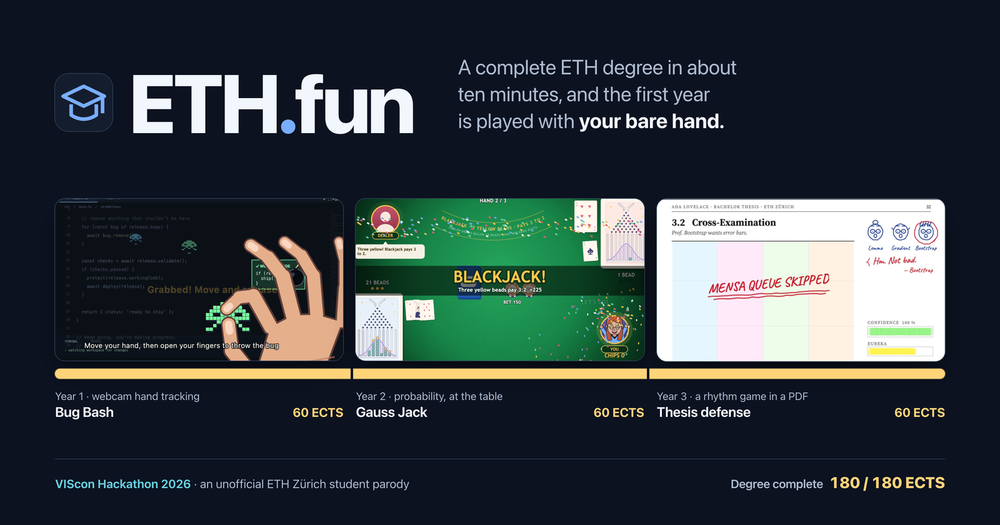
</p>

# ETH.fun

**A complete ETH degree in about ten minutes, and the first year is played with your bare hand.**

We built ETH.fun at VIScon Hackathon 2026. You create a student, play one minigame for each year of study, and the ECTS you earn decide where you end up: quant researcher in Zug, PhD student in year seven, or still flat-hunting in Zürich. This is the story of the game, how we built it, and what the booth taught us.

<p align="center">
  <a href="#the-idea">The idea</a> ·
  <a href="#your-first-day">Your first day</a> ·
  <a href="#year-1-bug-bash">Year 1</a> ·
  <a href="#year-2-gauss-jack">Year 2</a> ·
  <a href="#year-3-thesis-defense">Year 3</a> ·
  <a href="#graduation">Graduation</a> ·
  <a href="#how-we-built-it">How we built it</a> ·
  <a href="#what-we-learned">What we learned</a> ·
  <a href="#run-it-yourself">Run it yourself</a>
</p>

---

## The idea

Every ETH student knows the arc by heart: a first year that decides whether you stay, a probability course that never quite clicks, and a thesis defense in front of a committee that has read every footnote. We wanted a game that a stranger understands in seconds, laughs at, and wants to play again. So we made that arc the game.

The setting shaped every decision. The game runs on one laptop whose screen is mirrored to a projector, in a loud room, with people watching over the player's shoulder and turns that last about a minute. Every year is therefore one short minigame with its own mechanic, every screen has to read from three metres away, and nothing is allowed to block play: no account, no install, no controller, and a mouse fallback the moment a camera fails.

Starting takes one click. Each browser gets an anonymous player ID, the server keeps your character and progress, and the name you choose appears on the scoreboard.

## Your first day

<table>
<tr>
<td width="50%"></td>
<td width="50%">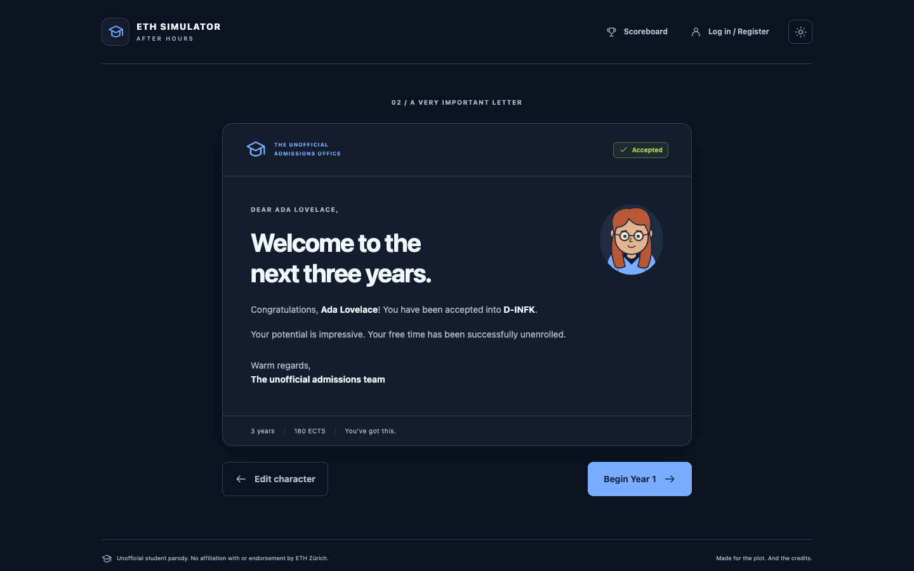</td>
</tr>
<tr>
<td><sub><b>The character builder.</b> A live student-ID preview and curated colour presets. The optional photo assist measures your skin tone on the device and asks a vision model for hair and eye colour from a single still.</sub></td>
<td><sub><b>The acceptance letter.</b> "Your potential is impressive. Your free time has been successfully unenrolled."</sub></td>
</tr>
</table>

Then your first day happens. Lectures, Practice Classes and the Lernphase each land a hit, Minecraft style, until a final Emotional Damage leaves you crying on half a heart. Only then does your avatar take its seat in the sidebar. The scene is skippable, and players who prefer reduced motion skip it entirely.

<p align="center">
  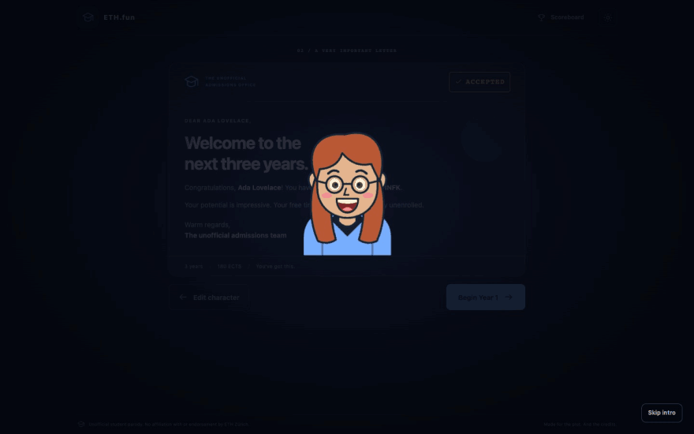
</p>

Every year opens the same way: three steps of how to play, illustrated with screenshots of the real game, and a **Start lecture** button. When the year is done, its panel turns into a gauge of the ECTS it paid out of 60, with a line that teases you about your score. Retries are for glory; the first result keeps its credits.

<table>
<tr>
<td width="50%">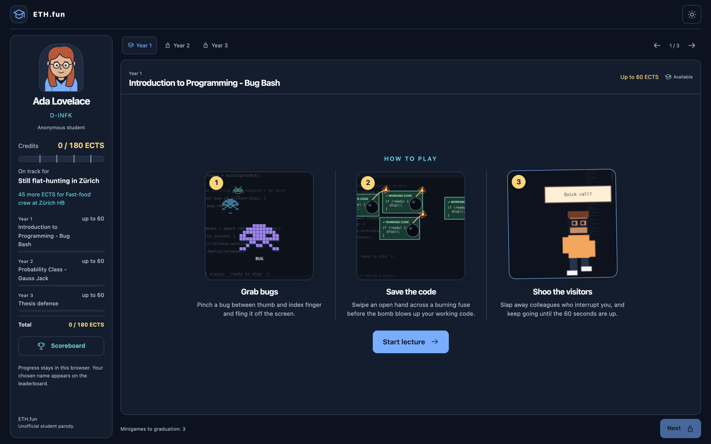</td>
<td width="50%">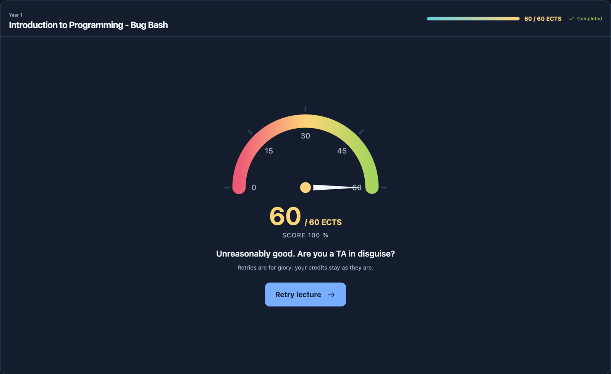</td>
</tr>
</table>

## Year 1: Bug Bash

*Introduction to Programming - Bug Bash* turns your first programming course into release day in an IDE, and you play it with your hand in the air.

<p align="center">
  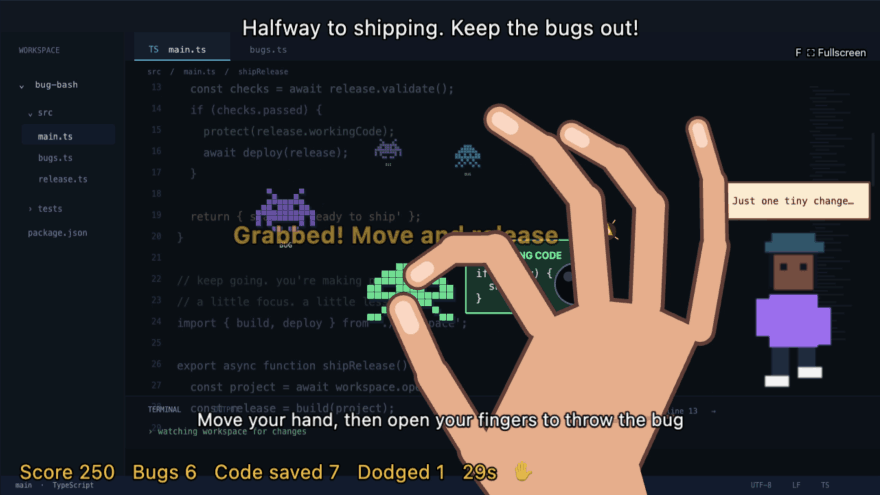
</p>
<p align="center"><sub>A real round, played by one of us in front of a laptop webcam. The cartoon hand is drawn from the 21 landmarks our server tracks in every camera frame.</sub></p>

Pixel-alien bugs crawl over the code, working-code cards arrive with a lit bomb fuse, and colleagues wander in with "Quick call?", "Works on my machine!" and "Can you fix my printer?". Three gestures handle all of it:

- **Pinch** a bug between thumb and index finger, move your hand, and open your fingers to throw it off the screen.
- **Swipe** an open hand across a card before its nine-second fuse reaches the bomb.
- **Slap** to knock out the colleague who is interrupting you.

A round lasts 30 seconds. A thrown bug is worth 10 points, saved code 25 and a dismissed colleague 15, and streaks add 5. An escaped bug costs 5, exploded code 15 and an empty grab 2. 163 points earn the year's full 60 ECTS. Without a camera the round carries on with the mouse: drag bugs, and press Space to swipe.

## Year 2: Gauss Jack

*Probability Class - Gauss Jack* is probability theory at a casino table: a blackjack variant we designed around the normal distribution.

<p align="center">
  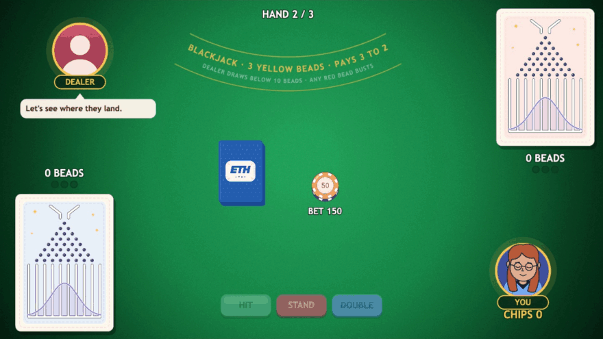
</p>
<p align="center"><sub>Hand two of a real game: all 150 remaining chips on the table, then three yellow beads for a blackjack that pays 3:2.</sub></p>

Every seat owns a Galton board instead of a hand. Each card turns its suit symbols into beads (an ace drops one, a face card ten) that bounce through eight rows of pins into nine columns, under a bell curve drawn over the board. A bead that lands under the curve is green, the one the curve crosses is yellow, and anything above it is red.

- Any red bead busts the board.
- Three yellow beads without a red one are a blackjack, which pays 3:2.
- Otherwise more beads beats the dealer, who draws below ten.

You get three hands and a 300-chip stipend. Keeping your stipend scores 50, doubling it scores 100, and the score pays its share of the year's 60 ECTS. The character you built sits at the table and reacts to every hand: it cries at a red bead and throws confetti at a blackjack.

<p align="center">
  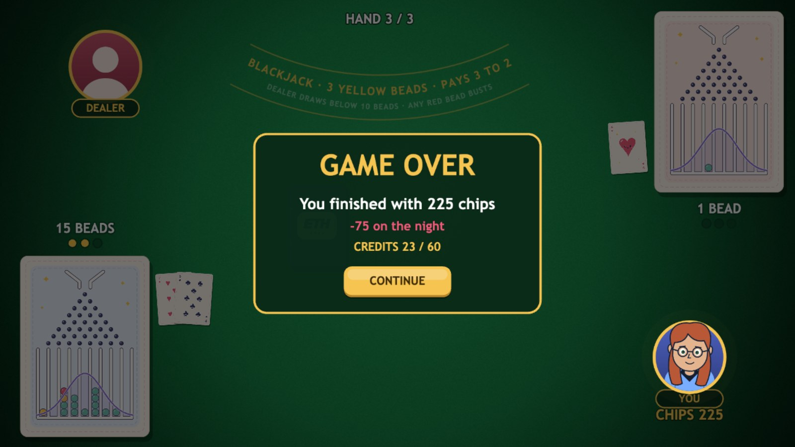
</p>

## Year 3: Thesis defense

Your bachelor thesis, open in a PDF viewer, defended live against a three-professor committee. It is a four-lane rhythm game: theorems, equations, figures and citations slide down Figure 3.1, and you highlight each one by pressing its lane's key (D for theory, F for proofs, J for experiments, K for critique) as it reaches the rule.

<p align="center">
  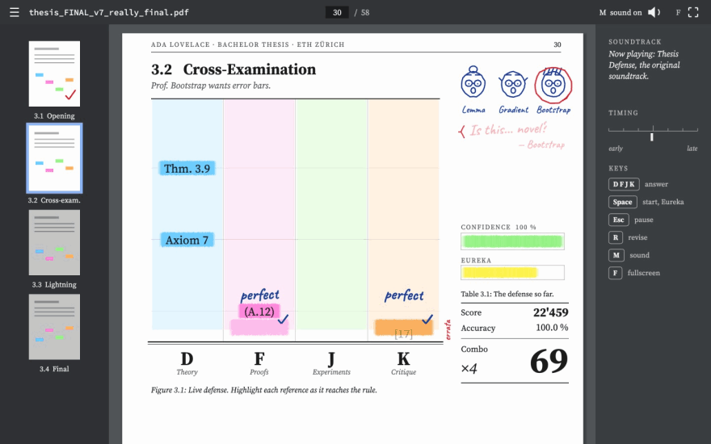
</p>
<p align="center"><sub>Cross-examination into the lightning round. This run is played by a script that presses the keys from the game's own chart, so it is flawless; yours will collect more red pen.</sub></p>

The committee is doodled in blue ballpoint in the margin and grades you in red pen: "Who supervised this?!", "Have you tried a larger n?!", "Who put tabs in your LaTeX?!". Milestones arrive in the same red ink, from PROMISING RESEARCH to MENSA QUEUE SKIPPED and FIELDS MEDAL SPEEDRUN. The level plays a track the team made, and every note sits on an onset of that track. Golden notes fill a Eureka meter; Space then doubles your points for eight seconds. If your thesis confidence runs out, the defense fails.

The verdict is an ETH transcript with the committee's rubber stamp. Your accuracy becomes a grade on the Swiss scale from 1 to 6, and every band has its own verdict: 4.0 IS A PASS and KOMPENSIERT near the line, A VERY SWISS 5.0 in the middle, SUMMA CUM LAUDE at the top, and EXMATRIKULIERT at the bottom.

<table>
<tr>
<td width="50%">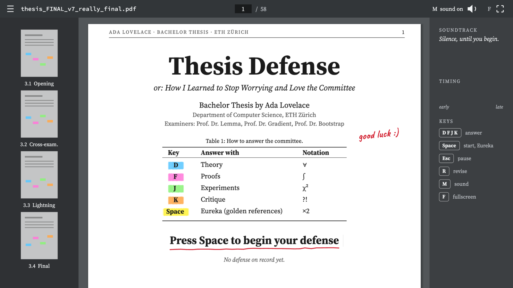</td>
<td width="50%"></td>
</tr>
</table>

## Graduation

Submitting your thesis graduates you on the spot. Each year paid its 60 ECTS in proportion to its score, and your share of the 180 picks the career:

| ECTS | Career |
|---|---|
| 153 and more | Quant researcher in Zug |
| 117 to 152 | PhD student at ETH, year 7 |
| 81 to 116 | Master's student at ETH (again) |
| 45 to 80 | Fast-food crew at Zürich HB |
| below 45 | Still flat-hunting in Zürich |

A credit transcript stays in view through the whole degree, so you always know what each game earned and how many ECTS the next career needs. The student in these recordings earned 60 in Bug Bash, 23 at the casino and 60 for the thesis: 143 ECTS, PhD student at ETH, year 7.

<p align="center">
  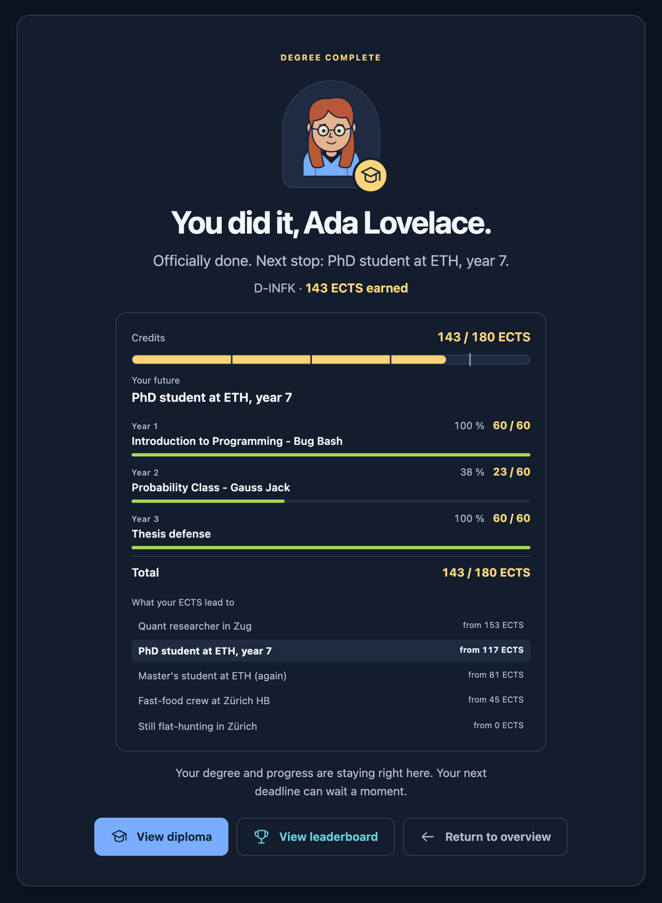
</p>

---

## How we built it

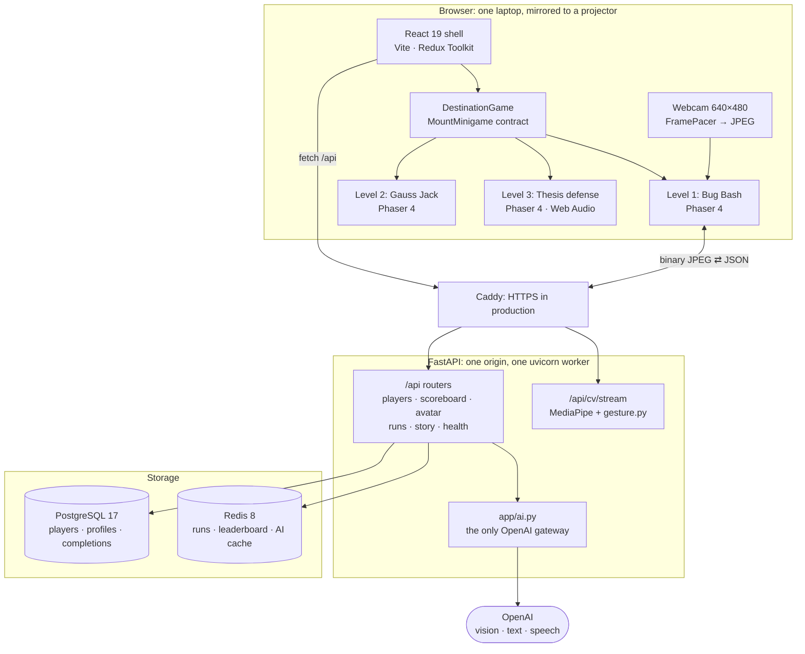

Four rules held the project together while five people built it in parallel:

1. **React owns everything around a round; Phaser owns the round.** They meet at one interface, `MountMinigame({ parent, character, dialogue, onFinish }) → { destroy() }` in [`frontend/src/games/shared/minigame.ts`](frontend/src/games/shared/minigame.ts). Game code never fetches, never navigates and never imports React.
2. **Each game is a plug-in level.** A minigame lives in `frontend/levelN/` (and `backend/levelN/` when it needs a server), with its own tests. It touches the shell only through hooks: the game registry, router registration, test paths, `tsconfig` and one `COPY` line in the Dockerfile. Three games grew side by side, each in its own folder.
3. **Words and numbers live in shared files.** Every player-facing string is in `shared/text.json`, and the years, ECTS and career thresholds are in `shared/game-config.json`, read by the frontend and the backend alike.
4. **Secrets and camera frames stay on the server.** Only `backend/app/ai.py` imports `openai`. Camera frames are analysed in memory and never stored; recording works only on a development server, when a developer presses **R**.

### Hand tracking on our own server

Finger detection runs in the backend ([decision #13](docs/DECISIONS.md)). The browser stays light: no 12 MB WASM runtime and no hand model competing with Phaser for the GPU, while the gesture logic is plain Python with pytest coverage. The price is a network hop on every frame, so we budgeted the latency explicitly.

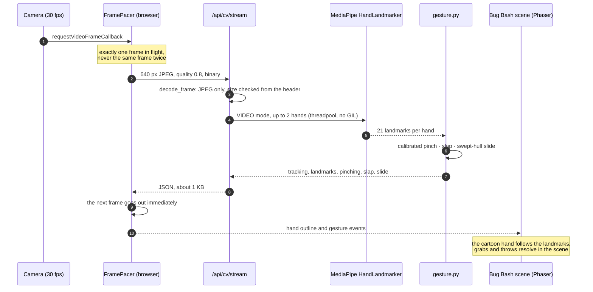

Measured on an Apple M4 on 10 October, before the pinch and slap rules were added (the full table is in [docs/SHOOTER_CV.md](docs/SHOOTER_CV.md#measurements)):

| Metric | Result |
|---|---|
| Engine time per 640 px frame of a real hand (median / p95) | **9.7 / 12.9 ms** |
| Round trip on localhost, native / in the production Docker image | **10.7 ms / 26.1 ms** |
| Four players at once, round trip each (median / p95) | **26 / ≤ 32 ms** (MediaPipe releases the GIL) |
| Engine answers per second in the browser | **30.1** (limited by the camera; 17 before `FramePacer`) |

### From landmarks to pinches, throws and slaps

MediaPipe gives us 21 points per hand and nothing more; every gesture in Bug Bash is our own geometry on top ([`backend/level1/gesture.py`](backend/level1/gesture.py), with the current rules in [docs/BUG_BASH.md](docs/BUG_BASH.md)).

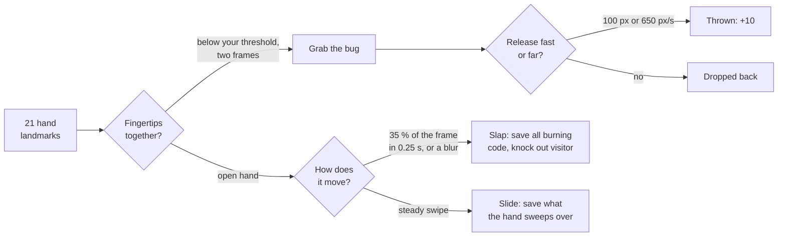

- **A pinch calibrated to your hand.** Hands and cameras differ, so every round starts with a pinch check: fingers apart, pinched, apart, pinched. The engine takes the 20th percentile of your open readings and the 80th of your pinched ones, demands a gap of at least 0.15 palm widths, and places grab and release at 30 % and 70 % of that gap. That hysteresis keeps a held bug from dropping when your fingers tremble. A gap that is too small gets a retry ("Separate your index finger and thumb more"), and Enter falls back to a standard pinch.

  <p align="center">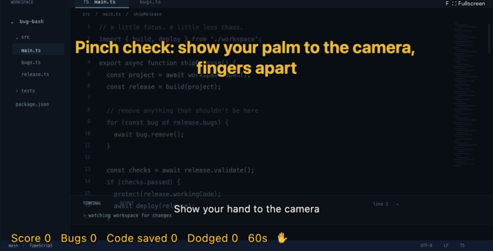</p>

- **Throws decided by the scene.** A grab reaches 1.8 times a bug's size, the held bug follows the midpoint of thumb and index, and a release counts as a throw after 100 game pixels of travel or at 650 pixels per second. A hand that drops out of tracking gets 350 ms of grace before the bug falls.
- **Slides that touch what they cross.** A swipe needs at least 12 % of the camera width within 0.9 s, an average of 0.3 widths per second and a mostly straight path. It then saves only the cards and colleagues touched by the swept outline of the whole hand between two frames: palm, thumb and fingers.
- **Slaps, even when the hand is a blur.** A fast slap (35 % of the frame in 0.25 s) saves every burning card and knocks out the visitor without aiming. A hand moving too fast for MediaPipe to see still counts: when at least 25 % of the watched area changes and the changed region moves at 0.9 frame widths per second, the engine calls it a slap.

### A public video endpoint, hardened

Anyone who can load the page can open the WebSocket, so we treat it as hostile input. Frames must be JPEG, at most 200 KB and 1280 px per side, checked from the header before decoding. An image side of 32 767 px or more aborts OpenCV inside MediaPipe and would kill the whole server process, so that limit is checked again right before the detector runs. Four camera slots are available at once, idle streams are closed after 20 seconds, control messages are capped at 1 KB and validated by Pydantic, and every failure (busy, unavailable, idle, denied camera, insecure origin) switches the round to the mouse instead of stopping it.

### Gauss Jack, balanced by simulation

The rules engine ([`frontend/level2/rules.ts`](frontend/level2/rules.ts)) decides every card, bead path and colour and emits an event log; the Phaser scene only plays it back, so the game is fully testable without a renderer. The curve's width (1.2 times the binomial over an expected 26 beads), the three-yellow blackjack and the dealer's stop at ten beads were searched together by simulation. Two million hands through today's rules give:

| | Gauss Jack | Classic blackjack |
|---|---|---|
| House edge | 2.3 % | about 0.5 % |
| Player blackjack | 3.0 % | 4.75 % |
| Dealer busts (when it plays) | 27 % | about 28 % |

The first search landed on a 0.5 % house edge. Then a playtest changed the rules, and the edge with them (see [what we learned](#what-we-learned)).

### A rhythm chart generated from the music

Year 3 plays the team's own 128 BPM track, and its chart is not written by hand. A development tool ([`backend/tools/thesis_chart.py`](backend/tools/thesis_chart.py), using librosa) fits the track's beat grid, measures onset strength and the dominant pitch at every sixteenth note, and writes `trackChart.ts`: every note sits on an onset, higher pitches go to lanes further right, and the four phases start on the track's own break bars at 15.0, 31.9 and 45.0 seconds. Per-phase budgets keep it fair (under four notes per second, bursts of at most four sixteenths), and the defense ends on a golden four-key QED chord. Presses are judged by the key event's own timestamp, ±45 ms for PERFECT, ±90 for GREAT and ±135 for GOOD, so a dropped frame never costs a hit. The music starts with the countdown, compensates the device's output latency, and the type is rendered at the screen's native resolution, so it stays sharp in fullscreen.

### AI that cannot spend credits by accident

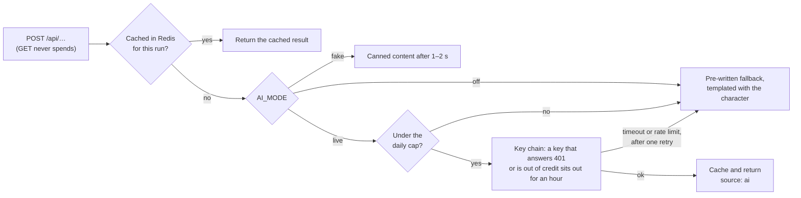

Every AI feature has a fallback, so players never see an AI error. pytest forces `AI_MODE=off`, swaps in a fake client and blocks all sockets, so an accidental real call fails the test, and the CI smoke test only sends GET requests. The photo assist in the character builder sends one still of at most 512 px, only on an explicit click, and it is never stored or logged.

### Progress without sign-up friction

A login form costs players at a booth. Each browser gets a random **player UUID** in `localStorage`, and the server keys profiles, completions and graduation by it ([#27](https://github.com/DEOIST/viscon26-main/pull/27)).

- **The server enforces the rules.** A year unlocks only when every game in the earlier years is complete, and placeholders can't award ECTS. Each year pays ECTS in proportion to its score (`POST …/completions/{game_id}` with `{"score": 0–100}`), and graduation needs all three years. A display name never grants access to a run.
- **Safe under concurrency.** Completions and graduation take a per-player row lock (`SELECT … FOR UPDATE`) and are idempotent, so double clicks and retries can't award ECTS twice.
- **Credit-spending guard.** The vision endpoint rejects requests whose `Origin` isn't on the allow-list, so another site can't spend our OpenAI budget through a player's browser.

---

## What we learned

**A projector changes the brief.** Year 3 started as a neon note highway, and it read as generic. The booth plays on a projector, where black ink on white paper and big numbers read from metres away, so we rebuilt it as a typeset thesis with flat highlighter lanes. The same reasoning gave Gauss Jack a fullscreen mode and put the credit transcript in the student record, after every game and on the diploma.

**Let the music write the chart.** Year 3 first ran on a hand-written chart, then on public-domain classics played by a Web Audio synthesiser. Once the team had its own track, we generated the chart from it, and every note now lands on something the player hears.

**Playtests find the rules you didn't write.** A playtest of Gauss Jack paid out blackjacks with a red bead on the board (2.5 % of hands) and did not count a dealer with a red bead as bust (1.5 %). Making any red bead a bust fixed both and raised the house edge from 0.5 % to about 2.3 %. We kept the rule a player can read at a glance and accepted the edge.

**Real hands are bigger than targets.** Bug Bash first saved code only when your hand touched the flame at the tip of the fuse, a 30-pixel target. Now touching the card anywhere counts. Playtests also asked for a slower round, bigger hit areas and more sensitive swipes. Slaps and slides now have separate cooldowns, because a slow swipe (often just the wind-up) kept swallowing the slap that came right after it.

**Never let a good round pay nothing.** Early mistakes could push Bug Bash's running score below zero, so a round with real catches sometimes paid 0 ECTS. The total now never drops below zero.

---

## Quality and delivery

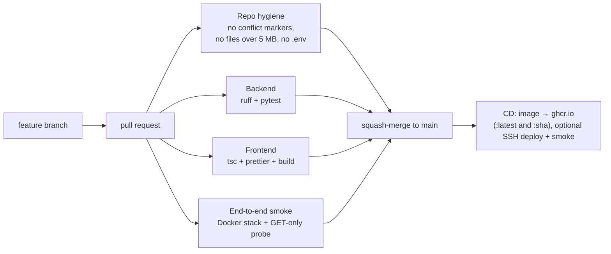

- **534 automated tests:** 263 in the backend (players, runs, endings, scoreboard, story, the AI gateway, moderation, the CV contract, gesture rules and replays of recorded play) and 271 in the frontend across 38 files (blackjack rules, the thesis chart, judging and verdicts, Bug Bash scoring, spawning, swipe hits and pinch calibration, the input lifecycle, the shell's admission flow, credits and diploma).
- **A protected `main`:** every change goes through a pull request with four required checks and is squash-merged ([docs/BRANCH_RULES.md](docs/BRANCH_RULES.md)).
- **Testing the camera without a camera:** in a headless browser, `getUserMedia` can be swapped for a canvas stream of hand photos, so the real pipeline (WebSocket, MediaPipe, gesture engine, scene) runs end to end in automation.

### Tech stack

| Layer | Choice | Why |
|---|---|---|
| Shell | **React 19 + TypeScript**, Vite, Redux Toolkit | Enrolment, the year panels and the credit transcript are classic UI; the degree state lives in one store, mirrored to the server by the anonymous player ID |
| Game engine | **Phaser 4** (WebGL with Canvas fallback) | One 2D engine for all three games, each on a 1280 × 720 logical canvas behind the same mount contract |
| Audio | **Web Audio** | Year 3's track and its sound effects (a cowbell for milestones, the Zürich tram bell for Eureka, a sad trombone for a failed defense), with latency compensation |
| Computer vision | **MediaPipe HandLandmarker** (Python), Pillow, NumPy | 21 landmarks per hand in about 10 ms per frame on a CPU, with our own gesture geometry on top |
| Backend | **FastAPI** + Pydantic v2 | A typed contract, mirrored in TypeScript (`schemas.py` ↔ `CommonInt.ts`), camelCase on the wire |
| Data | **PostgreSQL 17** (SQLAlchemy 2) · **Redis 8** | Players, profiles and completions with row-level locks; runs, the leaderboard and the AI cache and budget |
| AI | **OpenAI** (vision, structured outputs, speech, moderation) | Backend only, cached and capped, with a fallback for everything |
| Delivery | Multi-stage Docker, Compose with Caddy for HTTPS, GitHub Actions → GHCR | The same artifact runs locally, in CI and on the event VM |

The reasoning behind each choice, and the options we rejected, is in [docs/STACK.md](docs/STACK.md) and [docs/DECISIONS.md](docs/DECISIONS.md).

### API at a glance

Interactive docs are served at `http://localhost:8000/docs` in development and disabled in production.

| Area | Endpoints |
|---|---|
| Health and config | `GET /api/health` (no dependencies) · `GET /api/db-health` · `GET /api/config` |
| Players | `GET`/`PUT /api/players/{id}` · `POST /api/players/{id}/completions/{game_id}` · `POST /api/players/{id}/graduation` · `GET /api/scoreboard` |
| Avatar AI | `POST /api/avatar/suggestion` (Origin-checked, one still) |
| Computer vision | `GET /api/cv/status` · `WS /api/cv/stream` |
| Runs and story | `POST /api/runs` · `GET /api/runs/{id}` · `POST …/scores` · `POST …/graduate` · `POST …/dialogue` · `POST …/epilogue` · `POST …/epilogue/speech` · `GET /api/leaderboard` · `GET /api/leaderboard/endings` |

The full contract, with types, status codes and the Redis key layout, is in [docs/ARCHITECTURE.md](docs/ARCHITECTURE.md#api-contract).

---

## Run it yourself

**Requirements:** Node ≥ 22 (`frontend/.nvmrc`), Python ≥ 3.12, and Docker for the full stack. The camera needs a secure origin: `http://localhost` or HTTPS.

```bash
# Full stack in Docker: Postgres + Redis + backend + frontend
docker compose up --build -d          # or: make prod  →  http://localhost:5173

# Local development
make install                          # npm ci + backend/.venv
make dev                              # Vite + backend autoreload  →  http://localhost:5173
make check                            # tsc, prettier, vitest, ruff, pytest. Run before every push
make smoke                            # read-only end-to-end probe of a running app
```

**On the VIScon VM:** the managed address (`https://18.hackathon.ethz.ch`) doesn't support WebSockets, so the camera stream fails there and Bug Bash falls back to the mouse. Set the team page's ingress mode to **Custom** (server port 443, protocol HTTPS), open the ports with `sudo ufw allow 80,443/tcp`, and tell the Caddy service in `compose.yaml` the VM's domain so it gets a real certificate:

```bash
echo 'SITE_ADDRESS=18-direct.viscon-hackathon.ch' >> .env   # once, next to compose.yaml
docker compose up -d --build                                  # → https://18-direct.viscon-hackathon.ch
```

`make dev` needs Postgres for player progress: `docker compose up -d db` starts one on `127.0.0.1:5433`, which the backend's defaults already point at (or set `DATABASE_URL`). Redis is optional in development: without `REDIS_URL` the backend uses an in-process fakeredis. `AI_MODE` defaults to `off`, so running the game never spends OpenAI credits. Set it in `backend/.env` (see [`backend/.env.example`](backend/.env.example)).

**Demo tips:** light from the front and your palm facing the camera, 40 to 80 cm away. In Bug Bash, **F** toggles fullscreen, **T** repeats the pinch check during the warm-up, **Enter** skips it, **M** switches to the mouse and **C** resets the hand smoothing. Gauss Jack goes fullscreen with **F** too, and the Thesis defense takes **D F J K**, **Space** for Eureka and **Esc** to pause.

## Repository map

```
frontend/
├── src/                 React shell: App.tsx, store.ts (Redux), components/, minigames/, games/registry.ts
├── level1/              Level 1, Bug Bash: ShooterScene, CodeTargets, SlapWalkers, swipeHit, score (+ tests), input/ (camera, WebSocket, FramePacer)
├── level2/              Level 2, Gauss Jack: rules.ts (+ tests), board.ts, BlackjackScene, PlayerAvatar, sprite sheets
└── level3/              Level 3, Thesis defense: trackChart.ts, chart.ts, engine.ts, verdict.ts (+ tests), ThesisScene, Soundtrack
backend/
├── app/                 FastAPI: routers/, services/, schemas.py, ai.py (OpenAI gateway), database.py (Postgres), db.py (Redis)
├── level1/              CV engine: cv.py (MediaPipe), gesture.py, router.py (WebSocket), recorded play fixtures + tests
├── level2/              The blackjack dealer's dialogue + tests
└── tools/               ai_check.py, thesis_chart.py (development only, not in the image)
shared/game-config.json  Years, minigame slots, ECTS, careers and colour presets, shared by both sides
shared/text.json         Every player-facing string of the shell and the three minigames, by screen
docs/                    Game design, architecture, Bug Bash and CV deep dives, stack, decisions, playbook
```

## Roadmap

The core loop is complete. The next steps deepen it rather than widen it:

- **A narrated graduation.** The advisor dialogue, the AI-written epilogue and the rector's narration are already built and tested in the backend. Bringing them to the diploma screen gives every player a personal, spoken send-off.
- **Archetypes that change play.** The Gamer and ASVZ-athlete perks already exist in Bug Bash's configuration. Exposing archetypes in the character builder turns them into a real choice.
- **Head-to-head at the booth.** The CV engine already serves four players at once, so two students bashing bugs side by side is a natural next mode.

## Contributing

**Read [CLAUDE.md](CLAUDE.md) and [AGENTS.md](AGENTS.md) before contributing.** They cover conventions, the workflow and the branch rules. Then:

- [docs/GAME_DESIGN.md](docs/GAME_DESIGN.md): what we build
- [docs/ARCHITECTURE.md](docs/ARCHITECTURE.md): how it fits, the API contract, API keys, testing
- [docs/BUG_BASH.md](docs/BUG_BASH.md): Bug Bash's gestures, scoring and stream fields
- [docs/SHOOTER_CV.md](docs/SHOOTER_CV.md): the computer-vision engine and its measurements
- [docs/STACK.md](docs/STACK.md): tools, versions and rejected options
- [CONTRIBUTING.md](CONTRIBUTING.md): issues, branches, PRs, labels

## Team

ETH.fun was designed and built during VIScon Hackathon 2026 by [@ITheClixs](https://github.com/ITheClixs), [@Mer123haba456](https://github.com/Mer123haba456), [@ibrahim1metin](https://github.com/ibrahim1metin), [@toezcan](https://github.com/toezcan) and [@anomyq](https://github.com/anomyq).

<sub>ETH.fun is an unofficial student parody. It is not affiliated with or endorsed by ETH Zürich and uses no official logos. AI features use the OpenAI API. Every image was captured from the application running locally. The Bug Bash footage is a real round played by a team member on a laptop webcam; the Gauss Jack hands were played in a browser with random deals; the Thesis defense was played by a script that presses the keys from the game's own chart.</sub>
