<div align="center">

# ETH Simulator: After Hours

### A complete ETH degree in about ten minutes, controlled with nothing but your hand.

ETH Simulator turns the three defining moments of an ETH Zürich degree into three minigames: surviving the Basisprüfung, betting your stipend, and defending your thesis. Players walk up, raise a finger gun at the webcam and play. There is nothing to install, no controller to hand over and no account to create.


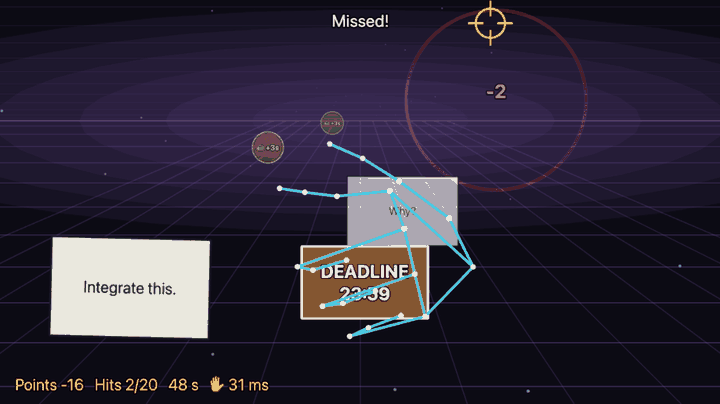

<sub>Recorded from the running application. The cyan skeleton is the hand our server tracks in every camera frame: the index finger aims, a dropped thumb fires.</sub>

</div>

---

## At a glance

| 3 | 0 | ~10 ms | 100 % | 432 |
|:---:|:---:|:---:|:---:|:---:|
| years, three original minigames, one diploma | controllers, installs or sign-ups required | server-side hand tracking per camera frame | of 63 labeled trigger pulls detected, with no false shots | automated tests behind every merge |

---

## The idea

Games at a crowded booth compete for about thirty seconds of attention. Most of that time usually goes to explaining the controls, so we removed the controls entirely. You point at the screen with your hand and the game understands you. The moment the skeleton locks onto your hand and the first exam question shatters is the moment people stop walking past.

A single gimmick holds attention for a minute, though. A story holds it for the full ten. So we built the gesture shooter into the arc every ETH student knows: enrol, survive three years, graduate. Each year is its own game with its own mechanic, and each one awards the ECTS that unlock the next.

## The experience

<table>
<tr>
<td width="33%" valign="top">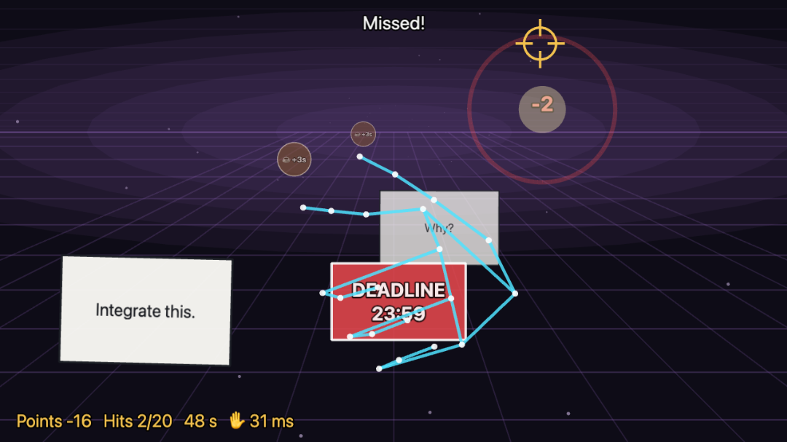<br/><b>Year 1: Basisprüfung</b><br/>A first-person shooting gallery played with a webcam finger gun. Exam questions, deadlines and coffee cups fly out of an endless exam hall. A three-shot warm-up teaches the gesture without any instructions.</td>
<td width="33%" valign="top">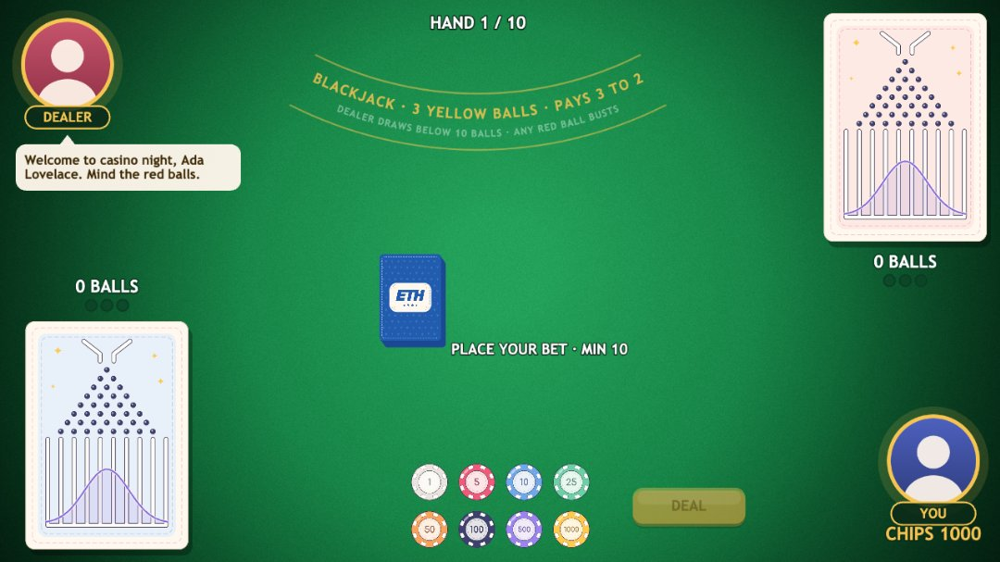<br/><b>Year 2: Probability Class - Gauss Jack</b><br/>Galton Blackjack, a blackjack variant we invented around the normal distribution. Every card turns into balls that fall through a Galton board. Overshoot the curve and you bust; land on it three times and it's blackjack. The odds were tuned over two million simulated hands to match the real game.</td>
<td width="33%" valign="top">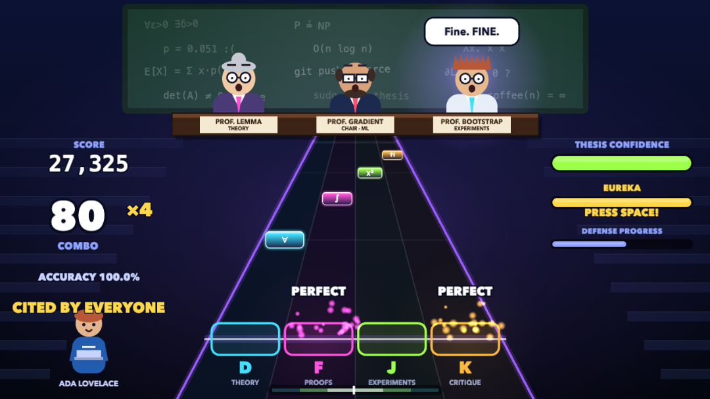<br/><b>Year 3: Thesis defense</b><br/>A four-lane rhythm game against a three-professor committee. Theory, proofs, experiments and critique arrive on the beat. Survive the professor's meltdown, land the final QED chord, and receive an ETH grade from 1 to 6.</td>
</tr>
</table>

Graduation closes the loop: a personalised diploma with your avatar, your department and every ECTS you earned, followed by your place on the public scoreboard.

## What sets it apart

- **Hand tracking as the controller.** No browser plugin, no depth camera and no separate calibration step. A standard laptop webcam streams to our own MediaPipe engine, and a gesture recognizer we wrote and validated on recorded play turns the hand into aim and trigger.
- **Mechanics with a point of view.** Each game is built around something ETH students actually know: the Basisprüfung, the bell curve, the thesis committee. The blackjack variant is original and mathematically balanced, not a reskin.
- **A complete product, not a demo.** Onboarding, character creation, an animated admission letter, three playable years, a real diploma and a leaderboard all work end to end and ship as a single Docker Compose stack.
- **Built for a booth.** One-click start with anonymous players, an automatic mouse fallback if a camera fails, skippable animations, and an AI layer that degrades gracefully when it's unavailable.

---

## Product tour

<table>
<tr>
<td width="50%">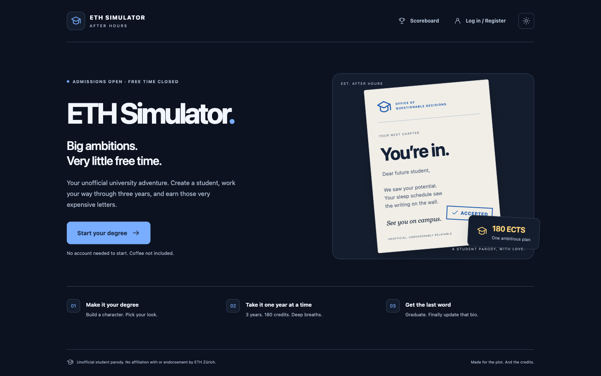<br/><sub><b>Landing.</b> One click to start, with no account and no password.</sub></td>
<td width="50%">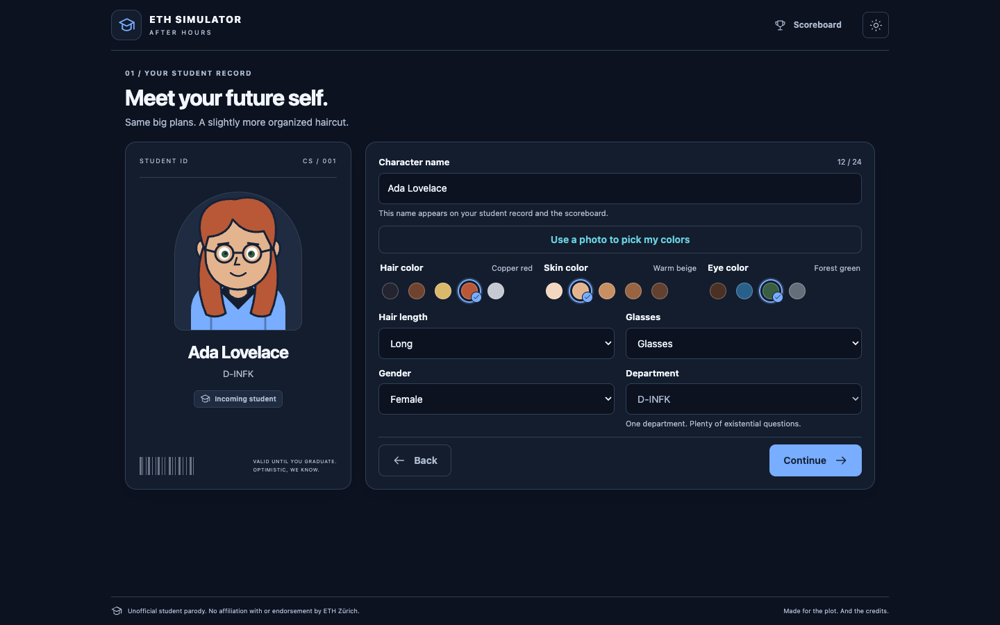<br/><sub><b>Character builder.</b> A live student-ID preview, curated colour presets, and an optional photo assist that suggests the player's colours.</sub></td>
</tr>
<tr>
<td>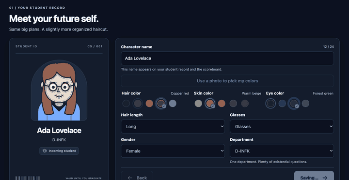<br/><sub><b>Admission.</b> The student ID is issued, then a personalised acceptance letter types itself out. It's skippable and respects <code>prefers-reduced-motion</code>.</sub></td>
<td>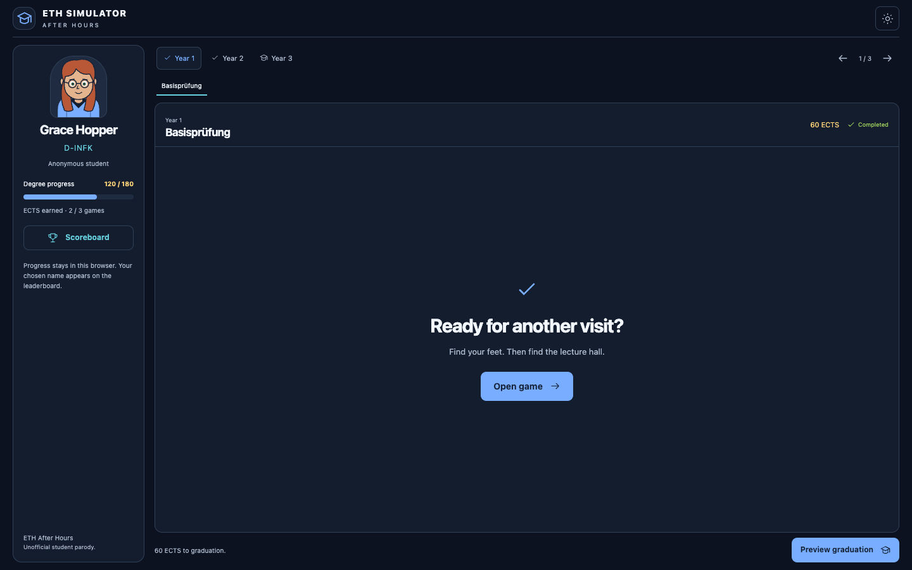<br/><sub><b>Degree hub.</b> Three years and 180 ECTS. Each year unlocks once the one before it is complete.</sub></td>
</tr>
<tr>
<td>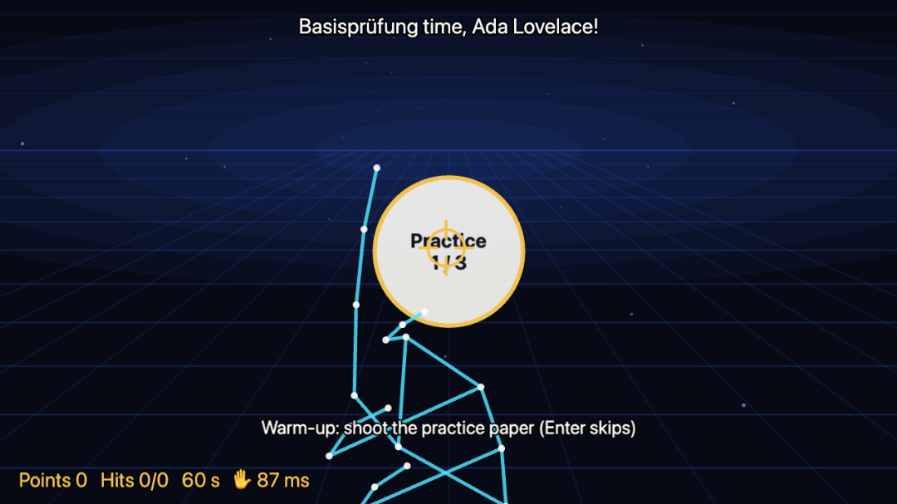<br/><sub><b>Basisprüfung warm-up.</b> Three practice targets teach the gesture while the engine calibrates to the player's resting hand.</sub></td>
<td>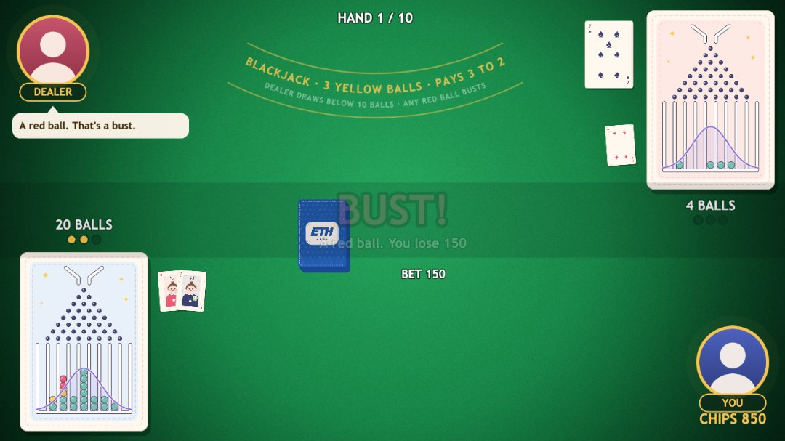<br/><sub><b>Gauss Jack.</b> A ball that stacks above the curve turns red and ends the hand.</sub></td>
</tr>
<tr>
<td>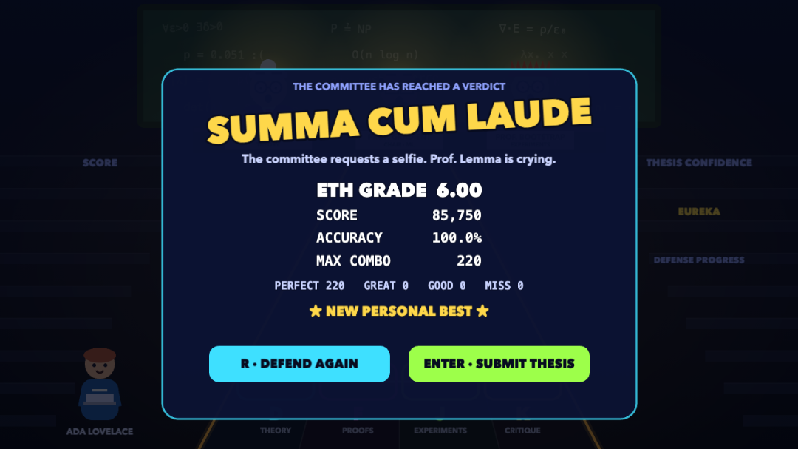<br/><sub><b>Thesis verdict.</b> Accuracy, maximum combo and an ETH grade, from "major revisions required" up to summa cum laude.</sub></td>
<td>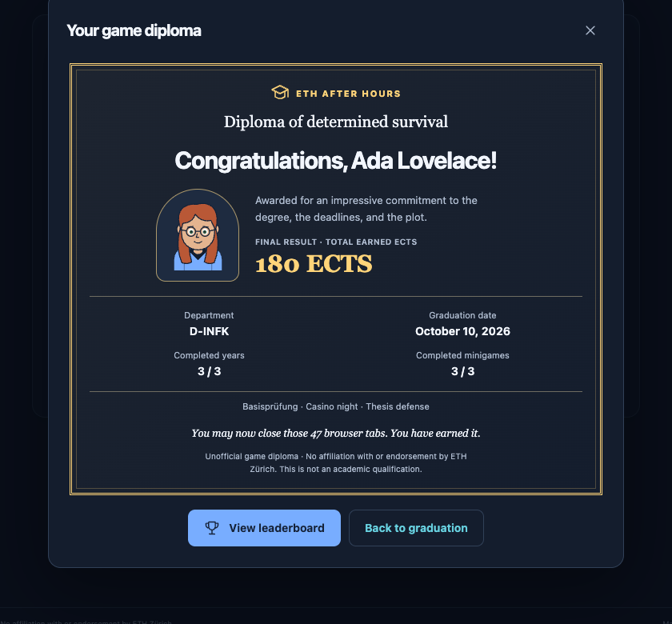<br/><sub><b>Diploma.</b> Issued at 180 ECTS with the player's avatar, department, graduation date and all three minigames.</sub></td>
</tr>
</table>

<table>
<tr>
<td width="50%">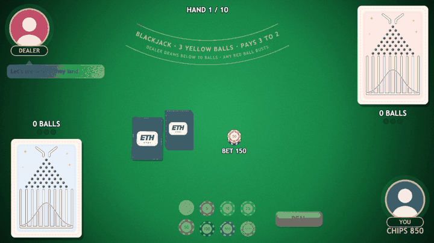<br/><sub>Galton Blackjack: each pip of a card is its own sprite and becomes a ball that bounces through eight rows of pins.</sub></td>
<td width="50%">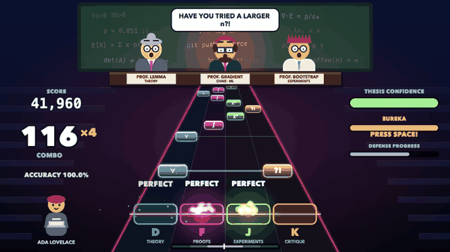<br/><sub>Thesis defense: the final phase at a 200-note combo with the 4x multiplier active.</sub></td>
</tr>
</table>

---

## How it maps to the judging criteria

| Criterion | Where to look |
|---|---|
| **Originality** | Controller-free play with a webcam finger gun. An original blackjack variant built on the normal distribution. A thesis defense told as a rhythm game. |
| **Technical depth** | A real-time computer-vision pipeline over a WebSocket, with a custom gesture recognizer that handles MediaPipe's failure modes. A simulation-balanced card game. An AI gateway that cannot spend credits by accident. Details in the [engineering deep dive](#engineering-deep-dive). |
| **Completeness** | Onboarding, character, admission, all three years, diploma and scoreboard work end to end, with server-side progress for anonymous players and a production Docker stack. Every image in this document was captured from the running application. |
| **Quality** | 432 automated tests (244 backend, 188 frontend), four required CI checks, continuous delivery to GHCR, and hardening against malformed camera input. |
| **Design** | One visual language from the landing page to the diploma, light and dark themes, accessible controls, and game feel: muzzle flash, shattering targets, a backdrop that reacts to every shot, and a committee that reacts to every answer. |

---

## Architecture

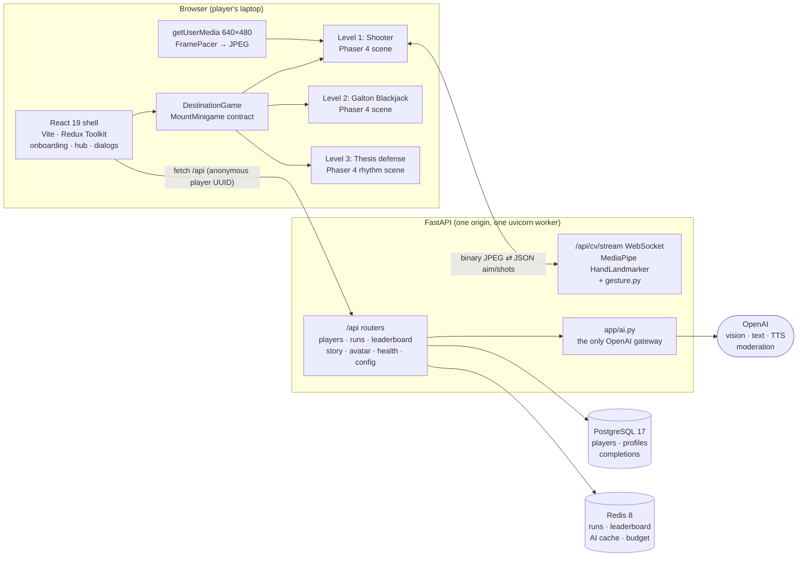

**Design rules that held across the event:**

1. **React owns everything around a round; Phaser owns the round.** They meet at a single interface, `MountMinigame({ parent, character, dialogue, onFinish }) → { destroy() }` in [`frontend/src/games/shared/minigame.ts`](frontend/src/games/shared/minigame.ts). Game code never fetches, never navigates and never imports React.
2. **Games are plug-in "levels".** Each minigame lives in `frontend/levelN/` and `backend/levelN/` with its own tests. It touches the shell only through hooks: the game registry, router registration, test paths, `tsconfig` and one `COPY` line in the Dockerfile. Three games were built in parallel by different people without merge conflicts in the shell.
3. **Secrets never reach the browser.** Only `backend/app/ai.py` imports `openai`. The keys are a server-side failover chain.
4. **Camera frames are never stored.** They are decoded in memory and analysed, and only landmarks and the aim go back. Recording works only on a development server, and only when a developer presses **R**.

---

## Engineering deep dive

### 1. Real-time hand tracking over the network

We moved finger detection **to the server** ([decision #13](docs/DECISIONS.md)). The browser stays light: no 12 MB WASM runtime, no hand model competing with Phaser for the GPU. The gesture logic is plain Python with pytest coverage. The price is a network hop on every frame, so we engineered the latency budget explicitly:

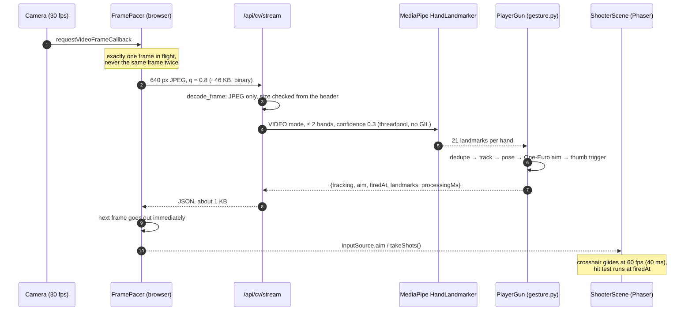

**Measured** on an Apple M4 (full table in [SHOOTER_CV.md → Measurements](docs/SHOOTER_CV.md#measurements)):

| Metric | Result |
|---|---|
| Engine time per 640 px frame of a real hand (median / p95) | **9.7 / 12.9 ms** |
| Round trip on localhost, native / in the production Docker image | **10.7 ms / 26.1 ms** |
| Four players at once, round trip each (median / p95) | **26 / ≤ 32 ms** (MediaPipe releases the GIL) |
| Engine answers per second in the browser | **30.1** (camera-limited; 17 before `FramePacer`) |
| Warm stream ready (connect + detector start) | 45–185 ms |

### 2. A gesture recognizer that copes with MediaPipe's failure modes

MediaPipe's built-in GestureRecognizer has no finger gun, so we wrote our own geometry on the raw landmarks ([`backend/level1/gesture.py`](backend/level1/gesture.py)). Pointing a finger *at* the camera is the hardest pose for a hand model, and we hit three problems:

- **Thumb/index label swaps (~15 % of frames).** With the index pointing at the lens, MediaPipe often labels the upright thumb as the index. Read naively, that is a fired shot and a jumping crosshair. Our trigger detects the swap: the "index" stands upright (< 35°) and over-extended (reach > 1.15). The aim uses only palm landmarks (wrist plus three knuckles) that a swap never moves.
- **Foreshortening.** A thumb folding *toward* the camera barely changes its angle in 2D, so the trigger watches two signals: the **angle** from vertical, and its **length** relative to a per-player upright length the engine learns on the fly. The learned length grows fast and shrinks slowly, so a fold barely moves it.
- **Jitter vs. lag.** The aim is a mouse in the air. The palm's offset from a calibrated neutral point × 4 gain runs through a **One-Euro filter** (Casiez et al., 2012), which smooths at rest and responds on fast moves. Shots land where the gun pointed **0.2 s earlier**, so dropping the thumb doesn't drag the shot.

```mermaid
stateDiagram-v2
    direction LR
    [*] --> Calibrating: stream opens
    Calibrating --> Aiming: palm held still for 15 frames (0.5 s)
    Aiming --> NoPose: no gun pose
    NoPose --> Aiming: pose
    Aiming --> Cocked: thumb < 32° and > 80 % of upright length
    Cocked --> Fired: thumb > 55° or < 70 % length, 2 frames in a row
    Fired --> Aiming: 250 ms cooldown (175 ms with the ASVZ perk)
    Aiming --> Lost: hand gone 300 ms
    Lost --> Aiming: new player hand
    note right of Fired
        firedAt = aim from 0.2 s earlier
    end note
```

<sub>"No gun pose": ring and pinky not curled. "New player hand": after 300 ms the largest visible hand becomes the player.</sub>

**Validated on real play:** four labeled recordings with **63 thumb drops** (both drop styles) are replayed in pytest. **Every drop fires, and nothing else does.** A second hand can't steal the crosshair (sticky player tracks), and duplicate detections of one hand are merged.

### 3. Hardening a public video endpoint

Anyone who can load the page can open the WebSocket, so we treated it as hostile input:

- **JPEG only.** Every other Pillow parser is attack surface. Frames are capped at 200 KB and 1280 px per side, checked from the header *before* decoding.
- **A native-crash guard.** An image side ≥ 32 767 px aborts OpenCV inside MediaPipe and kills the whole server process. The side limit is checked again right before the detector runs, and decompression bombs map to "Frame too large".
- **Resource caps.** Four concurrent camera slots (`CV_MAX_SESSIONS`, about one CPU core each), a 20 s idle timeout that frees the slot of a hidden tab, control messages capped at 1 KB and validated by Pydantic (no booleans, NaN or infinity), and `--ws-max-size` set to 1 MiB.
- **Graceful fallback.** Every close code (1013 busy, 1011 unavailable, 4000 idle), a denied camera or an insecure origin switches the round to **mouse mode** within 2 s, and the round continues.

### 4. Galton Blackjack, balanced by simulation

Each card drops as many balls as it has pips (Ace 1, faces 10). Each ball bounces left or right through 8 pin rows into 9 columns, so the stack follows a binomial distribution. The green/yellow/red rule, the curve width (1.2× the binomial over an expected 26 balls), "3 yellows = blackjack" and the dealer's stop at 10 balls were **searched together over 2 million simulated hands** in the pure, unit-tested rules engine ([`frontend/level2/rules.ts`](frontend/level2/rules.ts)):

| | Galton Blackjack | Classic blackjack |
|---|---|---|
| House edge | 0.5 % | ~0.5 % |
| Player blackjack | 4.8 % | 4.75 % |
| Dealer busts (when it plays) | 27 % | ~28 % |

The rules engine decides every card, ball path and colour and emits an event log. The Phaser scene only plays it back, so gameplay is fully testable without a renderer.

### 5. AI that cannot spend credits by accident

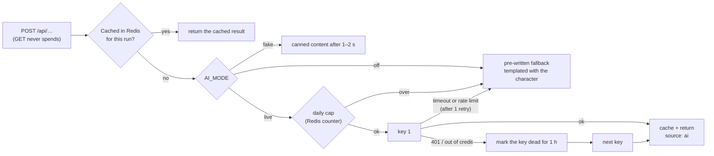

- **The player never sees an AI error.** Every AI feature has a fallback, and story endpoints answer 200 with `source: "fallback"` instead of a 5xx.
- **Tests can't reach OpenAI.** pytest forces `AI_MODE=off`, swaps in a `FakeAI` and blocks all sockets with `pytest-socket`, so an accidental real call fails the test. The CI smoke test sends GET requests only.
- **Privacy by design in the photo assist.** Skin tone is measured *in the browser* from three skin patches inside the face oval, using CIE L\* lightness (webcam colour casts make hue unreliable). One still of at most 512 px is sent, only on an explicit click, to pick hair and eye colours from the presets. It costs about $0.0002 per photo and is never stored or logged.
- **Story engine.** Advisor dialogue packs (Structured Outputs), a personal epilogue and rector-voiced TTS narration are built and tested behind the same gateway, with free name moderation in `live` mode.

### 6. Progress without sign-up friction

At a booth, a login form costs players. Each browser gets a random **player UUID** in `localStorage`, and the server keys profiles, completions and graduation by it ([#27](https://github.com/DEOIST/viscon26-main/pull/27)).

- **The server enforces the rules.** A year unlocks only when every game in the earlier years is complete. Placeholders can't award ECTS. Each year pays ECTS in proportion to its score (`POST …/completions/{game_id}` with `{"score": 0–100}`), and your share of the 180 ECTS picks your career. Graduation needs all three years. A display name never grants access to a run.
- **Safe under concurrency.** Completions and graduation take a per-player row lock (`SELECT … FOR UPDATE`) and are idempotent, so double clicks and retries can't double-award ECTS.
- **Zero-downtime migration.** An additive migration copies the earlier account records into the new tables without touching the old ones.
- **Credit-spending guard.** The vision endpoint rejects requests whose `Origin` isn't on the allow-list, so another site can't spend our OpenAI budget through a player's browser.
- **Diploma preview.** `GRADUATION_PREVIEW` (exposed at `GET /api/config`) lets the booth show the diploma early. It's UI-only and never completes games or changes results.
- `Cache-Control: no-store` on every API response, `X-Content-Type-Options: nosniff`, and no Swagger UI or OpenAPI schema in production. Redis and Postgres outages return a readable 503, not a stack trace.

---

## Tech stack

| Layer | Choice | Why |
|---|---|---|
| Outer shell | **React 19 + TypeScript**, Vite, Redux Toolkit | Menus, onboarding and the hub are classic UI. The degree state lives in one store, mirrored to the server by an anonymous player ID |
| Game engine | **Phaser 4** (WebGL, Canvas fallback) | One 2D engine for all three games. The shooter fakes depth with projection, scale, draw order and haze, so it needs no 3D engine and no extra GPU load next to the camera |
| Computer vision | **MediaPipe HandLandmarker** (Python), Pillow, NumPy | 21 landmarks per hand at about 10 ms per frame on a CPU, with our own geometry on top |
| Backend | **FastAPI** + Pydantic v2 | A typed contract, mirrored in TypeScript (`schemas.py` ↔ `CommonInt.ts`), with camelCase on the wire |
| Player progress | **PostgreSQL 17**, SQLAlchemy 2 | Relational data (players, profiles, completions) with row-level locks |
| Game data & cache | **Redis 8** (AOF) | Runs, a sorted-set leaderboard, the AI cache, the daily budget and dead-key flags |
| AI | **OpenAI** (vision, Structured Outputs, TTS, moderation) | Backend only, cached and capped, with a fallback for everything |
| Tests | pytest, fakeredis, pytest-socket · vitest, Testing Library, jsdom | Zero network and zero credits, by construction |
| Delivery | Multi-stage Docker (Node 26 → Python 3.12 slim, non-root), Compose, GitHub Actions → GHCR | The same artifact runs locally, in CI and on the server |

The reasoning behind each choice, and the options we rejected (Three.js, raw WebGL, CV in the browser, SSE streaming, runtime image generation, …), is in [docs/STACK.md](docs/STACK.md) and [docs/DECISIONS.md](docs/DECISIONS.md).

---

## Quality and delivery

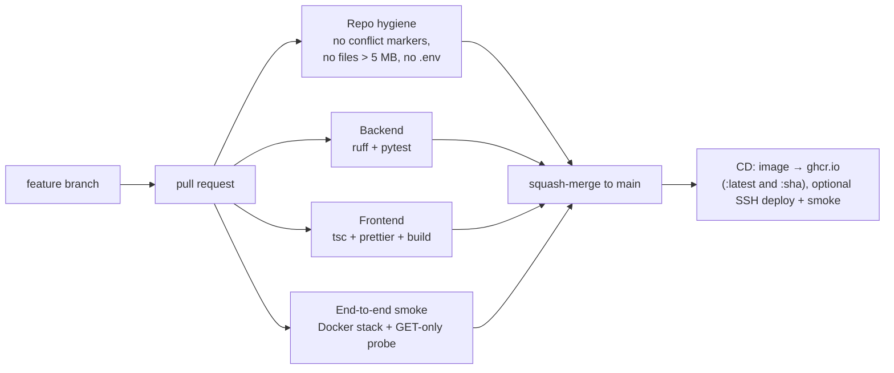

| | |
|---|---|
| **Backend tests** | 244 passing (players, runs, endings, leaderboard, story, AI gateway, moderation, CV contract, gesture replays, real-model checks) |
| **Frontend tests** | 188 passing across 27 files (blackjack rules, thesis chart, judging and verdicts, depth projection, hit tests, scoring, spawn, `FramePacer`, `SwitchableInput` lifecycle, character builder, admission flow, diploma, progression) |
| **Protected `main`** | Every change goes through a PR with four required checks, squash-merged ([docs/BRANCH_RULES.md](docs/BRANCH_RULES.md)) |
| **Testing the camera without a camera** | In a headless browser, Playwright swaps `getUserMedia` for a canvas stream of a hand photo, so the real pipeline (WebSocket, MediaPipe, gesture engine, scene) runs end to end. The GIF at the top was recorded this way |

---

## API at a glance

Interactive docs at `http://localhost:8000/docs` in development (disabled in production).

| Area | Endpoints |
|---|---|
| Health | `GET /api/health` (no dependencies) · `GET /api/db-health` |
| Players | `GET`/`PUT /api/players/{id}` · `POST /api/players/{id}/completions/{game_id}` · `POST /api/players/{id}/graduation` · `GET /api/scoreboard` · `GET /api/config` |
| Avatar AI | `POST /api/avatar/suggestion` (Origin-checked, one still) |
| Computer vision | `GET /api/cv/status` · `WS /api/cv/stream` |
| Runs and story | `POST /api/runs` · `GET /api/runs/{id}` · `POST …/scores` · `POST …/graduate` · `POST …/dialogue` · `POST …/epilogue` · `POST …/epilogue/speech` · `GET /api/leaderboard` · `GET /api/leaderboard/endings` |

The full contract, with types, status codes and the Redis key layout, is in [docs/ARCHITECTURE.md](docs/ARCHITECTURE.md#api-contract).

---

## Run it yourself

**Requirements:** Node ≥ 22 (`frontend/.nvmrc`), Python ≥ 3.12, and Docker for the full stack. The camera needs a secure origin: `http://localhost` or HTTPS.

```bash
# Full stack in Docker: Postgres + Redis + backend + frontend
docker compose up --build -d          # or: make prod  →  http://localhost:5173

# Local development
make install                          # npm ci + backend/.venv
make dev                              # Vite + backend autoreload  →  http://localhost:5173
make check                            # tsc, prettier, vitest, ruff, pytest. Run before every push
make smoke                            # read-only end-to-end probe of a running app
```

**On the VIScon VM:** the managed address (`https://18.hackathon.ethz.ch`) doesn't support WebSockets, so the camera stream fails there and Bug Bash falls back to the mouse. Set the team page's ingress mode to **Custom** (server port 443, protocol HTTPS), open the ports with `sudo ufw allow 80,443/tcp`, and tell the Caddy service in `compose.yaml` the VM's domain so it gets a real certificate:

```bash
echo 'SITE_ADDRESS=18-direct.viscon-hackathon.ch' >> .env   # once, next to compose.yaml
docker compose up -d --build                                  # → https://18-direct.viscon-hackathon.ch
```

`make dev` needs Postgres for player progress: `docker compose up -d db` starts one on `127.0.0.1:5433`, which the backend's defaults already point at (or set `DATABASE_URL`). Redis is optional in development: without `REDIS_URL` the backend uses an in-process fakeredis. `AI_MODE` defaults to `off`, so running the game never spends OpenAI credits. Set it in `backend/.env` (see [`backend/.env.example`](backend/.env.example)).

**Demo tips:** light from the front, hand 40–80 cm from the camera, thumb pointing at the ceiling. Press **C** to recalibrate the aim, **M** to switch to the mouse, and **Enter** to skip the warm-up.

---

## Repository map

```
frontend/
├── src/                 React shell: App.tsx, store.ts (Redux), components/, minigames/, games/registry.ts
├── level1/              Level 1, the shooter: ShooterScene, depth/hitTest/score/spawn (+ tests), input/ (camera, WebSocket, FramePacer)
├── level2/              Level 2, Galton Blackjack: rules.ts (+ tests), board.ts, BlackjackScene, sprite sheets
└── level3/              Level 3, Thesis defense: chart.ts, engine.ts, verdict.ts (+ tests), ThesisScene, committee and highway
backend/
├── app/                 FastAPI: routers/, services/, schemas.py, ai.py (OpenAI gateway), database.py (Postgres), db.py (Redis)
├── level1/              CV engine: cv.py (MediaPipe), gesture.py, router.py (WebSocket), recorded play fixtures + tests
└── level2/              The blackjack dealer's dialogue + tests
shared/game-config.json  Years, minigame slots, ECTS and colour presets, shared by both sides
shared/text.json         Every player-facing string of the shell and the three minigames, by screen
docs/                    Game design, architecture, CV deep dive, stack, decisions, playbook
```

---

## Roadmap

The core loop is complete. The next steps deepen it rather than widen it:

- **A narrated graduation.** The advisor dialogue, AI-written epilogue and rector narration are already built and tested in the backend. Bringing them to the diploma screen gives every player a personal, spoken send-off.
- **Archetypes that change play.** The Gamer and ASVZ-athlete perks already exist in the shooter's configuration and the engine protocol. Exposing archetypes in the character builder turns them into a real choice.
- **Per-player calibration** of the hand-skeleton overlay (the protocol message already exists), plus sound design and hit-stop for the shooter.
- **Multiplayer at the booth.** The CV engine already serves four concurrent players, so head-to-head shooter rounds are a natural next mode.

---

## Contributing

**Read [CLAUDE.md](CLAUDE.md) and [AGENTS.md](AGENTS.md) before contributing.** They cover conventions, the workflow and the branch rules. Then:

- [docs/GAME_DESIGN.md](docs/GAME_DESIGN.md): what we build
- [docs/ARCHITECTURE.md](docs/ARCHITECTURE.md): how it fits, the API contract, API keys, testing
- [docs/SHOOTER_CV.md](docs/SHOOTER_CV.md): the finger-gun computer vision
- [docs/STACK.md](docs/STACK.md): tools, versions and rejected options
- [CONTRIBUTING.md](CONTRIBUTING.md): issues, branches, PRs, labels

## Team

ETH Simulator: After Hours was designed and built during VIScon Hackathon 2026 by [@ITheClixs](https://github.com/ITheClixs), [@Mer123haba456](https://github.com/Mer123haba456), [@ibrahim1metin](https://github.com/ibrahim1metin), [@toezcan](https://github.com/toezcan) and [@anomyq](https://github.com/anomyq).

<sub>ETH Simulator is an unofficial student parody. It is not affiliated with or endorsed by ETH Zürich and uses no official logos. AI features use the OpenAI API. All screenshots and recordings were captured from the application running locally. For the shooter recordings, the webcam was simulated with the hand photos in `backend/level1/tests/fixtures/`, and the thesis defense was played by a scripted input sequence.</sub>
